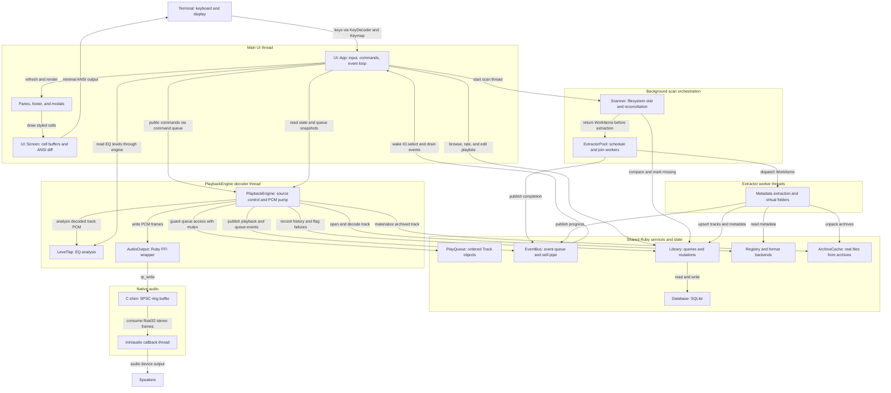

# Component map

Status: **current**, reviewed 2026-11-07 against implementation.

Start here for the major runtime components. Follow the [playback sequence](playback.md)
or [scan sequence](scanning.md) for execution order. Arrows label interactions;
boxes grouped by thread show where work executes, not separate processes.

## How to read the boundaries

- `UI::App` constructs and connects the services. Public engine methods may
  update the track queue under a mutex and/or enqueue decoder commands. The
  `PlayQueue` stores tracks; the command queue stores requests such as play,
  pause, and seek. Idle or paused decoding blocks until a command arrives.
- Registry dispatch is shared by scanning and playback. GME and OpenMPT use
  native libraries; the FFmpeg backend uses subprocesses. Backends receive
  real paths, including files materialized from archives.
- The decoder is the PCM producer; miniaudio's callback is the consumer.
  The boundary carries little-endian float32 interleaved stereo, with sizes
  defined by `AudioFormat`. The callback never calls Ruby and emits silence
  when paused or short of frames.
- EventBus carries notifications, not PCM. Its self-pipe wakes the UI's
  `IO.select`; App drains events and redraws when needed. Screen diffs cell
  buffers, and modals draw last so their cells overwrite underlying panes.

## Supporting paths

The main diagram omits supporting paths to keep the core flow readable:

- `ConfigStore` and the configuration DSL supply validated settings. App checks
  for changes and applies supported settings during the UI loop.
- Focus playback uses `FocusPlayer` to read infinite PCM generated by SoX.
  PlaybackEngine switches sources and pumps that PCM through the same
  AudioOutput. Focus preserves the finite queue and does not record history.
- Artwork is loaded by one `ArtFetcher` worker after `:track_started`, then
  returns through `:art_ready`; a request made while it is busy replaces any
  still-pending one. App discards artwork for a track that is no longer
  current, and `ArtPresenter` decides where the Kitty image is placed.
- Now Playing state (open page, live views, metadata probe) lives in
  `NowPlayingController`; App routes its keys and repaints.
- macOS media controls run in a helper subprocess (`MediaKeys`). Its
  commands arrive through EventBus, so they run on the UI thread like keys.
- Output effects run in the native callback; `EffectsRack` publishes their
  settings through `AudioOutput`.

## Source entry points

| Responsibility | Source |
|---|---|
| Composition, main loop, event handling, rendering | [UI::App](../../lib/rubyplayer/ui/app.rb) |
| Drawing and queue selection | [Screen](../../lib/rubyplayer/ui/screen.rb), [QueueSelection](../../lib/rubyplayer/ui/queue_selection.rb) |
| Library storage | [Library](../../lib/rubyplayer/library.rb), [Database](../../lib/rubyplayer/database.rb), [Track](../../lib/rubyplayer/track.rb) |
| Scan phases | [Scanner](../../lib/rubyplayer/scanner.rb), [ExtractorPool](../../lib/rubyplayer/extractor_pool.rb) |
| Playback and queue | [PlaybackEngine](../../lib/rubyplayer/playback_engine.rb), [PlayQueue](../../lib/rubyplayer/play_queue.rb) |
| Format dispatch and archives | [Registry](../../lib/rubyplayer/backends/registry.rb), [ArchiveCache](../../lib/rubyplayer/archive_cache.rb) |
| Audio transport and analysis | [AudioOutput](../../lib/rubyplayer/audio_output.rb), [AudioFormat](../../lib/rubyplayer/audio_format.rb), [LevelTap](../../lib/rubyplayer/level_tap.rb), [C shim](../../ext/rp_audio/rp_audio.c) |
| Notifications | [EventBus](../../lib/rubyplayer/event_bus.rb) |
| Supporting paths | [ConfigStore](../../lib/rubyplayer/config.rb), [FocusPlayer](../../lib/rubyplayer/focus_player.rb), [Artwork](../../lib/rubyplayer/artwork.rb), [ArtFetcher](../../lib/rubyplayer/art_fetcher.rb), [MediaKeys](../../lib/rubyplayer/media_keys.rb), [EffectsRack](../../lib/rubyplayer/effects_rack.rb) |
| Now Playing and album art | [NowPlayingController](../../lib/rubyplayer/ui/now_playing_controller.rb), [ArtPresenter](../../lib/rubyplayer/ui/art_presenter.rb), [KittyImage](../../lib/rubyplayer/ui/kitty_image.rb) |

[Back to project README](../../README.md#architecture)
