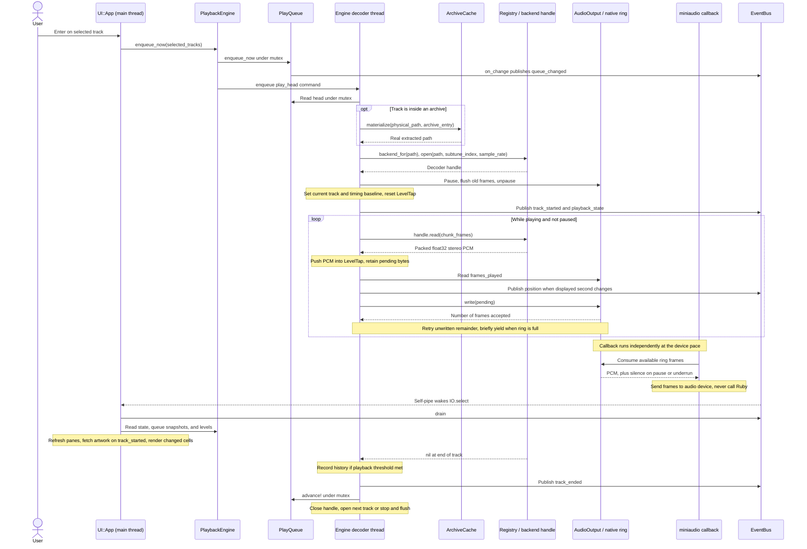

# Playback sequence

Status: **current**, reviewed 2026-10-10 against implementation.

This follows normal finite-track playback after Enter selects a track. It
assumes the track opens successfully and is not skipped by the disliked-track
rule. See the [component map](components.md) for thread boundaries.

## Timing and ownership

This is a logical walkthrough, not a schedule: UI event draining and the native
callback run concurrently with decoding. `pump` alternates between reading a
chunk and writing pending PCM; it does not discard a chunk when the ring accepts
only part of it. Position notifications are checked after chunk reads and
throttled to changes in the displayed second.

Playback position comes from **consumed** native frames, adjusted for the track
baseline and seek offset. Decoded frames may be buffered ahead of what is heard.
History uses this playback position and is recorded during finish/stop handling
only if the configured duration percentage (or unknown-duration seconds) is met.

Pause and seek enter through the command queue. Paused and idle decoding blocks
on that queue. A seek pauses and flushes old audio, seeks the handle, resets
pending PCM and timing, then restores pause state.

Open or decode failures flag the track as errored, publish `:track_error`, and
advance the queue. Recovery keeps the decoder thread alive. Focus sounds use a
different source: SoX PCM via `FocusPlayer`, pumped by the same decoder thread;
they preserve the finite queue and bypass playback history.

## Source entry points

| Step | Source and methods |
|---|---|
| Selection and command routing | [UI::App](../../lib/rubyplayer/ui/app.rb): `play_now`, `enqueue`, `handle_events` |
| Decoder lifecycle | [PlaybackEngine](../../lib/rubyplayer/playback_engine.rb): `enqueue_now`, `run`, `play_head`, `open_and_play`, `pump`, `finish_and_advance`, `record_history` |
| Ordered tracks | [PlayQueue](../../lib/rubyplayer/play_queue.rb) |
| Archive path resolution | [ArchiveCache](../../lib/rubyplayer/archive_cache.rb): `materialize` |
| Format selection and decoding | [Registry](../../lib/rubyplayer/backends/registry.rb), [GME](../../lib/rubyplayer/backends/gme.rb), [OpenMPT](../../lib/rubyplayer/backends/openmpt.rb), [FFmpeg](../../lib/rubyplayer/backends/ffmpeg.rb) |
| PCM transport and device callback | [AudioOutput](../../lib/rubyplayer/audio_output.rb): `write`, `frames_played`; [C shim](../../ext/rp_audio/rp_audio.c): `rp_write`, `data_callback` |
| UI wakeup | [EventBus](../../lib/rubyplayer/event_bus.rb): `publish`, `drain` |

[Component map](components.md) · [Library scan sequence](scanning.md) · [Project README](../../README.md#architecture)
